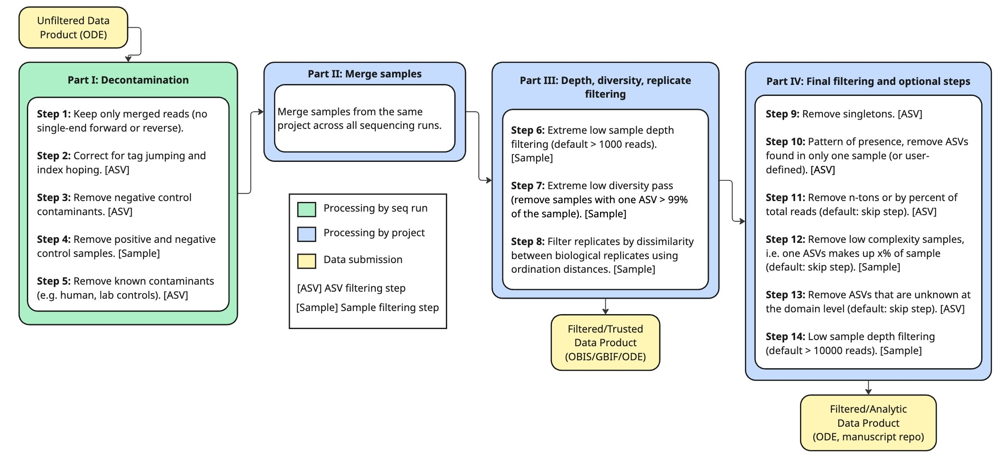

<!-- README.md is generated from README.Rmd. Please edit that file -->

```{r, include = FALSE}
knitr::opts_chunk$set(
  collapse = TRUE,
  comment = "#>",
  fig.path = "man/figures/README-",
  out.width = "100%"
)
```

# SDDQA

<!-- badges: start -->
<!-- badges: end -->

SDDQA is your one stop shop for all things metabarcoding run sequencing data decontamination and quality assurance. The process is broken up into four steps, 1) decontamination with negative and positive controls, 2) merging across sequencing runs, 3) depth, diversity and replicate filtering of seqs, and 4) final filtering and optional steps. 

*Note: This package is currently under development*

## Installation

You can install the development version of SDDQA from [GitHub](https://github.com/) with:

``` r
# install.packages("pak")
pak::pak("DiatomSetta/SDDQA")
```

## Example

This is a basic example which shows you how to solve a common problem:

```{r example}
library(SDDQA)
## basic example code
```

<!-- You'll still need to render `README.Rmd` regularly, to keep `README.md` up-to-date. `devtools::build_readme()` is handy for this. -->

You can also embed plots, for example:

```{r, echo = FALSE, out.width = "100%", fig.align = "center"}

```


### Disclaimer

*This repository is a scientific product and is not official communication of the National Oceanic and Atmospheric Administration, or the United States Department of Commerce. All NOAA GitHub project code is provided on an ‘as is’ basis and the user assumes responsibility for its use. Any claims against the Department of Commerce or Department of Commerce bureaus stemming from the use of this GitHub project will be governed by all applicable Federal law. Any reference to specific commercial products, processes, or services by service mark, trademark, manufacturer, or otherwise, does not constitute or imply their endorsement, recommendation or favoring by the Department of Commerce. The Department of Commerce seal and logo, or the seal and logo of a DOC bureau, shall not be used in any manner to imply endorsement of any commercial product or activity by DOC or the United States Government.*
